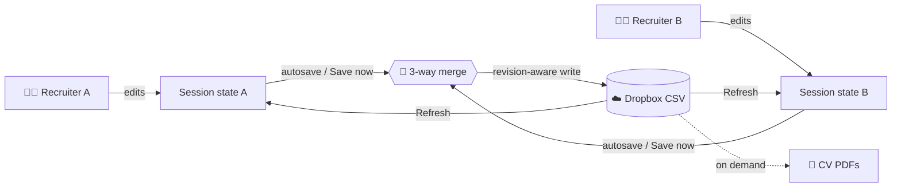

# 🎓 Hi! PARIS Career Fair — Recruiter App

### Find the right candidates. Keep every follow-up moving. ⚡

A lightweight **Streamlit** workspace for the Hi! PARIS Career Fair. Recruiters search candidates, open CVs, track follow-ups and check Doodle bookings, while **several colleagues edit the same candidate list at the same time** through Dropbox.

> **5 sponsors · 5 applications · 1 smoother career-fair workflow.**

📘 **Recruiters:** jump straight to the [User Guide](USER_GUIDE.md).
🛠️ **Organisers / developers:** you are in the right place.

---

## ✨ What it does

| | Feature |
|---|---|
| 🔐 | Sponsor-specific recruiter login (`Argon2`-hashed passwords) |
| 🔎 | Accent- and case-insensitive candidate search |
| 📄 | One-click CV retrieval from Dropbox |
| 👁️ ⭐ 💾 ✉️ | Four shared status flags: **Viewed**, **Interested**, **CV saved**, **Contacted** |
| 🔄 | Safe multi-recruiter editing with three-way merge and manual **Refresh** |
| 💿 | Debounced autosave plus a **Save now** button |
| 📊 | Live statistics and status filters |
| 📅 | One-click access to the sponsor's Doodle editor board |

---

## 🧠 How it works (the 60-second version)



1. 📥 The app loads the sponsor's candidate-state CSV from Dropbox.
2. ✍️ Each browser session keeps its **own working copy**.
3. 💾 Saves go through a merge step so one recruiter does not overwrite another.
4. 🔄 Remote changes become visible on **Refresh**. Never assume sync is instantaneous.
5. 📄 CV PDFs are fetched from Dropbox only when requested.

### 🔀 Concurrency model

Each session remembers a **base** snapshot (what it last synced), its **local** edits, and the **remote** file. On save or refresh the app performs a **three-way merge** per candidate and per column:

| Situation | Result |
|---|---|
| Different candidates edited | ✅ both kept |
| Same candidate, different flags | ✅ both kept |
| Same flag, same new value | ✅ no conflict |
| Same flag, different values | ⚠️ conflict reported, **local value wins** |

Candidates are identified by a stable key built from **first name + last name + CV path**, so two people named *Jean Martin* with different CVs stay separate.

---

## 🚀 Quick start

```bash
python -m venv .venv
source .venv/bin/activate          # Windows: .venv\Scripts\Activate.ps1
python -m pip install --upgrade pip
pip install -r requirements.txt
streamlit run my_app.py            # or app_<sponsor>.py
```

Each sponsor needs its **own** recruiter credentials, CSV and Doodle links.

---

## 🔐 Secrets and Git hygiene

> ⚠️ **NEVER commit secrets or real candidate data.** Deleting a secret in a later commit does **not** remove it from Git history.

Keep out of Git: Dropbox tokens, app secrets, passwords and password hashes, real CVs, candidate CSVs. Add `.streamlit/secrets.toml` to `.gitignore` **before** creating it.

### Recruiter accounts

Generate hashes with `generate_recruiter_password_hashes.py`, then store them as `authentication_handler.py` expects (looked up by lower-cased username):

```toml
# .streamlit/secrets.toml
[recruiters.loreal]
password_hash = "$argon2id$v=19$..."
recruiter_id  = "rec-loreal-1"
```

The username must equal the sponsor's `ALLOWED_USERNAME` in the entry point.

### Two Doodle links, two audiences

| Link | Used by | Purpose |
|---|---|---|
| **Participant link** | Students | Scan the QR code and book a 5-minute slot |
| **Editor / organiser link** | Recruiters | See who booked (the 📅 Doodle button) |

QR codes point to the **participant** link. The app button points to the **editor** link.

---

## ☁️ Dropbox setup

### Candidate CSV (one per sponsor)

| Column | Meaning |
|---|---|
| `first_name`, `last_name` | Candidate identity |
| `file_path` | Dropbox path of the CV (must exist) |
| `seen` | Profile viewed |
| `intend_view` | Marked interesting |
| `cv_saved` | CV saved |
| `contacted` | Candidate contacted |

```csv
first_name,last_name,file_path,seen,intend_view,cv_saved,contacted
Alice,Photon,/CVs_2026/Photon_Alice.pdf,0,0,0,0
Bob,Neutron,/CVs_2026/Neutron_Bob.pdf,1,1,0,0
```

Fake CVs for testing live in `test_CVs/fake_CVs`.

### Access credentials

Create an app in the [Dropbox App Console](https://www.dropbox.com/developers/apps). A **refresh token** is preferred for long-running deployments:

```toml
DROPBOX_APP_KEY       = "YOUR_APP_KEY"
DROPBOX_APP_SECRET    = "YOUR_APP_SECRET"
DROPBOX_REFRESH_TOKEN = "YOUR_REFRESH_TOKEN"
# alternative: DROPBOX_ACCESS_TOKEN = "..."
```

Get the refresh token by opening this URL with your app key, clicking **Allow**, then exchanging the code:

```
https://www.dropbox.com/oauth2/authorize?client_id=XXX&response_type=code&token_access_type=offline
```

`token_access_type=offline` is what makes Dropbox issue a long-lived refresh token. The account must be able to **read** the CSV and CVs and **write** the CSV. A wrong path gives a `not_found` error.

---

## 🌐 Deploy on Streamlit Community Cloud

One deployment per sponsor, each with its own URL and its own secrets.

1. Push the code to GitHub (entry points, modules, `requirements.txt`, `assets/`, `images/`).
2. On [share.streamlit.io](https://share.streamlit.io/) choose **Create app**, pick repo, branch and the sponsor entry point.
3. In **Advanced settings → Secrets**, paste that sponsor's TOML.
4. Deploy, then test login and the Dropbox connection.

Sponsor-specific keys follow a suffix pattern:

```toml
STATE_DBX_PATH_LOREAL    = "/CV-CareerFair/loreal/career_fair_all_candidates_loreal.csv"
DOODLE_URL_EDITOR_LOREAL = "https://YOUR_LOREAL_DOODLE_EDITOR_LINK"
# repeat with _CAPGEMINI, _SCHNEIDER, _TOTAL, _VINCI
```

### Project layout

```text
project/
├── my_app.py / app_<sponsor>.py   # entry points
├── authentication_handler.py
├── audit_logger.py
├── dropbox_storage.py
├── merge_handler.py
├── ui_render.py
├── create_qr_codes.py
├── requirements.txt
├── assets/styles.css
├── images/
├── tests/
└── README.md
```

### ✅ Isolation check, per sponsor

Correct logo · correct CSV · correct CV folder · Doodle button opens the **editor** board · only the intended credentials work · the app cannot write to another sponsor's CSV.

> A public Streamlit URL is **not** public access to candidate data. Protect both the app (login) and the storage (Dropbox permissions).

---

## 📱 Student QR codes

`create_qr_codes.py` reads the five participant URLs from secrets and builds QR codes carrying the Hi! PARIS and sponsor logos.

```toml
DOODLE_URL_TO_SHARE_LOREAL = "https://YOUR_LOREAL_PARTICIPANT_LINK"
# also _CAPGEMINI, _SCHNEIDER, _TOTAL, _VINCI
```

```bash
pip install "qrcode[pil]" Pillow streamlit
python create_qr_codes.py                    # square modules (default)
python create_qr_codes.py --drawer rounded   # or circle
python create_qr_codes.py --help             # logo sizes and paths
```

Output goes to `qr_codes_simple_dual_centered_square/`, one PNG per sponsor. **Scan every code on a phone before printing**, check the booking flow end to end, and verify the printed size still scans.

---

## 🧪 Tests

```bash
pip install -r tests/requirements-test.txt
python -m pytest tests/ -q
python -m pytest tests/ --cov=authentication_handler --cov=merge_handler --cov=dropbox_storage --cov-report=term-missing
```

| Area | What is checked |
|---|---|
| 🔀 Concurrency | Merge rules, no lost edits across many simultaneous recruiters |
| 🧬 Candidate identity | Keys, missing values, same-name candidates |
| 🔐 Authentication | Valid, invalid and malformed credentials |
| 🖥️ UI | Login, log-out, search, toggles, filters, refresh (Streamlit `AppTest`, Dropbox mocked) |

`AppTest.from_file()` resolves relative paths from the test file's folder, so tests use an absolute `APP_PATH` defined in `tests/conftest.py`.

---

## 🛠️ Troubleshooting

| Symptom | Check |
|---|---|
| `Failed to load CSV from Dropbox: not_found` | Exact `STATE_DBX_PATH_*`, leading `/`, capitalisation, token access |
| 🔐 Login fails | Right sponsor app, `[recruiters.<user>]` secret, username equals `ALLOWED_USERNAME` |
| 📄 CV does not open | `file_path` in the CSV, file exists, Dropbox read access, pop-ups allowed |
| 💾 Save fails | Write permission, CSV path, error message; keep the tab open |
| 🔄 Colleague's edits missing | Press **Refresh**, make sure your own save finished first |
| 📅 Wrong Doodle page | `DOODLE_URL_EDITOR_<SPONSOR>` must be the editor link |
| 📱 iPhone PDF problems | Use Chrome; Safari may not download PDFs |

---

## 🔒 Security and data handling

Names and CVs are personal data. Keep secrets and data out of Git, restrict Dropbox access to the required folders, verify login on every deployment, hide debug panels and detailed exceptions from users, and review where authentication and activity logs are stored and for how long.

---

## ✅ Launch checklist

**Deployment**
- [ ] Five sponsor apps deployed with correct branding, CSV paths and credentials
- [ ] Dropbox access works for CSVs and CVs
- [ ] Secrets live in Streamlit Cloud, not GitHub

**Students**
- [ ] Participant Doodle links configured, QR codes generated, tested on Android and iPhone, printed and labelled

**Recruiters**
- [ ] Search, the four flags, Open CV, Save now, autosave work
- [ ] **Refresh tested with two simultaneous sessions**
- [ ] Conflicting edits tested and understood
- [ ] No pending edits lost when changing filters or refreshing
- [ ] Doodle button opens the editor board

---

## 🚀 Roadmap

1. 🧩 **One configurable app for all sponsors.** A validated per-sponsor config (name, logo, CSV path, Doodle URL, allowed recruiter), selected by deployment secret rather than a URL parameter, with tests proving sponsors cannot be crossed.
2. 🧪 **More tests.** CSV schema validation, Dropbox failure paths, sponsor isolation, unchecking after a concurrent update.
3. 📈 **Locust load testing.** Streamlit sessions run over WebSockets, so plain HTTP load tests do not simulate a recruiter. Use a WebSocket-aware or browser-based client against staging with synthetic data, and measure latency (median, p95, p99), failed saves, Dropbox throttling and write contention.

---

<sub>Built for the Hi! PARIS Career Fair 🎓</sub>